# Egg Segmentation and Multi-Object Tracking Take-Home Report

**Candidate:** K. Sree Varun Aahil  
**Dataset:** Roboflow Egg Dataset (110 images, 640x640, grouped dev/eval 88/22)  
**Video Test:** YouTube `Y4JyV94y2_A` (1280x720 table experiment, 1440 frames @ 24.0 fps)  
**Annotated Video:** [https://drive.google.com/file/d/1mCqreRT5OFuGm49fvgxRKH-TVVOL1kWt/view?usp=sharing](https://drive.google.com/file/d/1mCqreRT5OFuGm49fvgxRKH-TVVOL1kWt/view?usp=sharing)  
**Submission Date:** October 30, 2026  

---

## 1. Executive Summary

This report presents an end-to-end computer vision solution for egg segmentation and multi-object tracking under challenging conditions, including touching instances, boiling water, high-contrast table textures, and hand occlusions. Ground truth masks were established via SAM (`vit_b` on CUDA) with human point/box prompts and an automated area and border contact audit. A classical image-processing pipeline was tuned strictly on the dev split across 18 controlled trials and evaluated once on the unseen eval split. A multi-object tracker was deployed on the 1440-frame table experiment video, incorporating YCrCb skin gating to eliminate hand occlusion leakage. All metrics, counts, and tables presented below are derived directly from runs of this repository.

### Key Measured Results
- **Ground Truth Integrity:** 110 clean SAM masks generated via `SamPredictor` (`vit_b` on CUDA) using human point prompts and tight bounding boxes for boiling water edge cases. 0 flagged suspicious masks remaining.
- **Classical Pipeline (Dev Split, n=88):** Pixel Mean IoU = **0.4018** (95% CI: [0.3435, 0.4603], Median = 0.3147), Dice = **0.5200**, Detection F1 = **0.4087**, Mean Count Error = **2.20**.
- **Classical Pipeline (Eval Split, n=22):** Pixel Mean IoU = **0.3196** (95% CI: [0.1978, 0.4268], Median = 0.2502), Dice = **0.4239**, Detection F1 = **0.3206**, Mean Count Error = **1.68**.
- **Video Tracking (1440 frames):** 1440 frames processed at 24.0 FPS. **2 unique tracks** created across the video (1:1 mapping with the 2 real physical eggs), with **15 loss events** and **15 recoveries**. At least one egg was detected in 782 of the 783 active demonstration frames (frame 480 had 0 detections). Hand occlusion and fingertip leakage at frame 600 resolved using YCrCb skin gating and morphological opening (gating reduced the total foreground mask by 2296 px over the whole frame; restricted to crop x in [200, 460], y in [300, 430], the mask was reduced by 1304 px). Identities were checked by hand on the 14 frames of the events sheet and the timeline, and no swap was seen; the tracker's internal id_switches heuristic counter was 0.

---

## 2. Task 1: Ground Truth Mask Generation (SAM)

### Approach
- Model: Segment Anything Model (`vit_b`, 375 MB checkpoint) running on CUDA.
- Interactive point annotations stored in `points.json` via `src/annotate_points.py` with multi-mask score selection (`multimask_output=True`).
- Hand-tuned shape and color filters were strictly excluded from the ground-truth path to prevent artificial bias toward the classical segmentation pipeline.
- Ground truth egg count distribution across 110 images:
  - **1 egg:** 93 images (84.5%)
  - **2 eggs:** 6 images (5.5%)
  - **3 eggs:** 11 images (10.0%)

### Ground Truth Quality Audit & Fixes (`out/sam/gt_fix_audit.json`)
Initial automated SAM passes on boiling water images (`not_damaged_124`, `not_damaged_135`, `not_damaged_145`) flooded the entire pot interior (up to 81.9% of frame). An automated border and area audit was built into `src/contact_sheet.py` flagging masks > 40% area or touching > half of the image border.
Bounding box prompts were added around the egg boundaries for these boiling pot scenes (verified in `out/sam/gt_fix_audit.json`):
- `not_damaged_124`: BBox `[280, 150, 520, 400]` reduced area fraction from 81.9% (335354 px, 978 border contacts) to **13.4%** (54995 px, 0 border contacts).
- `not_damaged_135`: BBox `[270, 170, 520, 420]` reduced area fraction from 79.5% (325584 px, 994 border contacts) to **14.2%** (58113 px, 0 border contacts).
- `not_damaged_145`: BBox `[250, 200, 480, 450]` reduced area fraction from 62.5% (256010 px, 665 border contacts) to **13.2%** (54032 px, 0 border contacts).
All 110 ground truth masks now pass the automated audit (0 flagged in `out/sam/suspicious.txt`).

### Dataset Split Integrity & Leakage Audit (`out/eval/split_leakage_audit.txt`)
- **Dataset Composition:** 110 images total (640x640), grouped by source filename prefixes and perceptual hashing (`phash_distance <= 8`).
- **Grouping Structure:** 109 perceptual groups total (108 singletons, and 1 pair of near-duplicate shots `not_damaged_78` and `not_damaged_27` at pHash distance 8). Both images of this pair were placed strictly into the `dev` split.
- **Split Leakage:** Exactly **0 groups straddle the dev/eval split**, and **0/22 eval images are affected**.
- **Leak-Free Evaluation:** Recomputing evaluation metrics on the leak-free eval subset yields identical metrics to the full eval set: Pixel IoU = **0.3196**, Dice = **0.4239**, Detection F1 = **0.3206**.
- **Augmentation Check:** The dataset contains no synthetic geometric or photometric augmentations (crops, rotations, color shifts, flips) sharing pHash distance &le; 8. Full audit logs are available in `out/eval/split_leakage_audit.txt`.

---

## 3. Task 2: Classical Segmentation & Parameterized Experiment Harness

### Pipeline Architecture
A single parameterized pipeline `segment_pipeline` in `src/classical_segment.py` supports:
1. Color spaces: Grayscale, CLAHE, CIELAB L*, border-color Euclidean distance, HSV gating.
2. Thresholding: Standard Otsu, Inverted Otsu, Adaptive Gaussian, Border-contrast polarity detection.
3. Morphology: Elliptical opening and closing sweeps (7x7, 15x15, 25x25), hole filling.
4. Outlier & Clutter Rejection: Area pruning (min area 500 to 2500 px), geometric shape ranking.
5. Instance Separation: Conservative Euclidean distance transform watershed.

### Controlled Experiment Progression
Trials were tracked in `experiments.csv`. Keep/discard decisions compare strictly against the parent's dev IoU. Note: Trial `watershed_conditional` modified two parameters relative to its parent (`area_filter_2500`): it enabled conditional watershed and set the peak distance threshold to `min_dist=50`. Under this trial, Detection F1 rose from 0.3084 to 0.4087, mean signed count error rose from +0.45 to +2.20 (over-splitting), pixel IoU unchanged. Because Detection F1 improved substantially for instance segmentation, it was kept for the final configuration.

**The Kept Pipeline Chain:**  
`baseline -> morph_small -> morph_medium -> morph_large -> area_filter_2500 -> watershed_conditional -> final (eval)`

### Complete Measured Experiment Log (`experiments.csv`)

| Trial ID | Parent | Split | What Changed | Dev IoU | Dev Dice | Det F1 | Cnt Err | Decision | Reason |
|:---|:---|:---|:---|:---:|:---:|:---:|:---:|:---:|:---|
| `baseline` | `None` | dev | Grayscale conversion + Gaussian blur (5x5) + Otsu threshold + hole fill + min area 500 | 0.3513 | 0.4693 | 0.2071 | 3.12 | **BASELINE** | Baseline established on dev (IoU 0.3513, Dice 0.4693, DetF1 0.2071) |
| `otsu_inv` | `baseline` | dev | Invert Otsu thresholding | 0.0823 | 0.1424 | 0.0000 | 3.36 | **DISCARD** | Fails to improve dev IoU over parent 'baseline' (0.0823 vs 0.3513, -0.2690) |
| `clahe_otsu` | `baseline` | dev | CLAHE local contrast equalization (clip 2.0, tile 8x8) before Otsu | 0.2562 | 0.3791 | 0.0799 | 8.22 | **DISCARD** | Fails to improve dev IoU over parent 'baseline' (0.2562 vs 0.3513, -0.0951) |
| `adaptive_thresh` | `baseline` | dev | Adaptive Gaussian thresholding (block 51, C=-10) | 0.0634 | 0.1119 | 0.0065 | 12.33 | **DISCARD** | Fails to improve dev IoU over parent 'baseline' (0.0634 vs 0.3513, -0.2878) |
| `lab_l` | `baseline` | dev | CIELAB L* perceptual lightness channel + Otsu | 0.3244 | 0.4437 | 0.1665 | 3.67 | **DISCARD** | Fails to improve dev IoU over parent 'baseline' (0.3244 vs 0.3513, -0.0268) |
| `hsv_gate` | `baseline` | dev | HSV color gating (S < 70, V > 130) | 0.3456 | 0.4665 | 0.1587 | 4.32 | **DISCARD** | Fails to improve dev IoU over parent 'baseline' (0.3456 vs 0.3513, -0.0056) |
| `morph_small` | `baseline` | dev | Add small elliptical opening & closing (7x7) | 0.3558 | 0.4740 | 0.2161 | 2.89 | **KEEP** | Improves dev IoU over parent 'baseline' from 0.3513 to 0.3558 (+0.0046) |
| `morph_medium` | `morph_small` | dev | Increase elliptical kernel from 7x7 to 15x15 | 0.3766 | 0.4964 | 0.2363 | 2.34 | **KEEP** | Improves dev IoU over parent 'morph_small' from 0.3558 to 0.3766 (+0.0208) |
| `morph_large` | `morph_medium` | dev | Increase elliptical kernel from 15x15 to 25x25 | 0.3972 | 0.5161 | 0.2642 | 1.25 | **KEEP** | Improves dev IoU over parent 'morph_medium' from 0.3766 to 0.3972 (+0.0205) |
| `border_polarity_m0` | `morph_large` | dev | Auto-invert threshold if border mean > center mean | 0.3698 | 0.4821 | 0.2409 | 1.07 | **DISCARD** | Fails to improve dev IoU over parent 'morph_large' (0.3698 vs 0.3972, -0.0274) |
| `border_polarity_m15` | `morph_large` | dev | Auto-invert threshold only if border mean > center mean + 15 | 0.3945 | 0.5119 | 0.2596 | 1.25 | **DISCARD** | Fails to improve dev IoU over parent 'morph_large' (0.3945 vs 0.3972, -0.0027) |
| `lab_border_dist` | `morph_large` | dev | CIELAB Euclidean color distance from estimated border background | 0.3603 | 0.4582 | 0.2673 | 2.55 | **DISCARD** | Fails to improve dev IoU over parent 'morph_large' (0.3603 vs 0.3972, -0.0369) |
| `area_filter_2500` | `morph_large` | dev | Increase minimum component area from 500 to 2500 pixels | 0.4018 | 0.5200 | 0.3084 | 0.45 | **KEEP** | Improves dev IoU over parent 'morph_large' from 0.3972 to 0.4018 (+0.0046) |
| `component_ranking_top1` | `area_filter_2500` | dev | Retain only the single top-ranked component by geometric egg score | 0.3746 | 0.4761 | 0.3295 | -0.33 | **DISCARD** | Fails to improve dev IoU over parent 'area_filter_2500' (0.3746 vs 0.4018, -0.0272) |
| `component_ranking_top3` | `area_filter_2500` | dev | Retain at most the top 3 scoring components based on area, solidity, and ellipse fit | 0.3972 | 0.5092 | 0.3133 | 0.27 | **DISCARD** | Fails to improve dev IoU over parent 'area_filter_2500' (0.3972 vs 0.4018, -0.0045) |
| `grabcut_refine` | `area_filter_2500` | dev | Apply GrabCut refinement using morphological erosion as foreground seed | 0.4038 | 0.5177 | 0.3073 | 0.38 | **DISCARD** | Marginal IoU gain (+0.0021) but Dice degrades from 0.5200 to 0.5177 (-0.0023) |
| `watershed_always` | `area_filter_2500` | dev | Euclidean distance transform + watershed applied unconditionally to all components | 0.4018 | 0.5200 | 0.3537 | 3.90 | **DISCARD** | Fails to improve dev IoU over parent 'area_filter_2500' (0.4018 vs 0.4018, +0.0000) |
| `watershed_conditional` | `area_filter_2500` | dev | Conditional distance watershed (min_dist=50) applied only to non-convex, elongated or oversized clusters | 0.4018 | 0.5200 | 0.4087 | 2.20 | **KEEP** | Dev IoU tied with parent 'area_filter_2500' (0.4018); kept on tiebreaker: DetF1 improves from 0.3084 to 0.4087 (+0.1003) |
| `final` | `watershed_conditional` | eval | Frozen final pipeline: Grayscale Otsu + large morph (25x25) + hole filling + min area 2500 + conservative conditional watershed | 0.3196 | 0.4239 | 0.3206 | 1.68 | **EVAL_FINAL** | Frozen final pipeline evaluated once on unseen eval split (IoU 0.3196, Dice 0.4239, DetF1 0.3206) |

---

## 4. Task 3: Quantitative & Qualitative Evaluation vs Ground Truth

### Dev vs Eval Metric Comparison

| Metric | Dev Split (n=88) | Eval Split (n=22) | Definition / Match Criteria |
|:---|:---:|:---:|:---|
| **Pixel IoU (Mean)** | **0.4018** | **0.3196** | TP / (TP + FP + FN) across foreground pixels |
| **Pixel IoU (Median)** | **0.3147** | **0.2502** | Median per-image pixel IoU |
| **Pixel Dice (Mean)** | **0.5200** | **0.4239** | 2 * TP / (2*TP + FP + FN) |
| **Pixel Precision** | **0.4488** | **0.3449** | TP / (TP + FP) |
| **Pixel Recall** | **0.8461** | **0.8749** | TP / (TP + FN) |
| **Detection Precision** | **0.3563** | **0.2758** | Hungarian matched eggs / Predicted eggs |
| **Detection Recall** | **0.5966** | **0.4621** | Hungarian matched eggs / Ground truth eggs |
| **Detection F1** | **0.4087** | **0.3206** | Harmonic mean of detection precision & recall |
| **Count Error (Mean)** | **2.20** | **1.68** | Mean signed count error (Pred - GT) |
| **Count Error (Abs Mean)**| **2.20** | **1.77** | Mean absolute count error |

### Bootstrap 95% Confidence Intervals & Dev vs Eval Analysis
- **Dev Split Mean IoU:** 0.4018 (Bootstrap 95% CI: [0.3435, 0.4603])
- **Eval Split Mean IoU:** 0.3196 (Bootstrap 95% CI: [0.1978, 0.4268])

Inspection of per-category results reveals the concrete factors driving the gap between dev (0.4018) and eval (0.3196):
1. **Disproportionate Concentration of Container and Packaging Scenes:** Eval contains 10 "Egg on container / lid / plain surface" images (45.5% of eval) with a low mean IoU of **0.2190**. In these scenes, plastic food-container lids, bowls, metal pans, and packaging rims reflect light and distend Otsu threshold boundaries into wide false-positive blobs.
2. **Camouflage and Hand Occlusions:** Eval includes 2 white plastic egg tray images (`not_damaged_116` and `117`) with near-zero contrast, averaging **0.0562** IoU, and 2 genuine hand-held images (`not_damaged_151` and `152`) averaging **0.1098** IoU. In addition, 3 boiling pot images (`not_damaged_114`, `128`, `147`) average **0.3072** IoU. Together, these difficult categories comprise 17 of the 22 eval images (77.3% of eval).
3. **Higher Ratio of Clean Tabletop and Multi-Egg Scenes in Dev:** In contrast, the dev split benefits from 27 tabletop scenes with higher contrast (mean IoU **0.5353**), 11 multi-egg scenes (mean IoU **0.6148**), and 5 foliage scenes (mean IoU **0.6805**)—together comprising 43 of 88 dev images (48.9% of dev).
4. **Small-Sample Variance:** Because eval has only 22 images, its bootstrap 95% confidence interval spans widely ([0.1978, 0.4268]) and encompasses the dev mean. While domain composition (especially the 45.5% container/lid prevalence) explains the lower point estimate, the wide confidence interval confirms substantial small-sample variance.

### Domain Composition Check (`out/eval/composition_check.json`)
To evaluate how much of the performance gap between the dev split (mean IoU **0.4018**) and eval split (mean IoU **0.3196**) is attributable to category distribution shift, we re-weighted the dev per-category mean IoUs by the eval category counts:
- **Actual Dev Split Mean IoU:** 0.4018
- **Actual Eval Split Mean IoU:** 0.3196
- **Predicted Eval Split Mean IoU (Dev Category Means Weighted by Eval Counts):** **0.3324**
- **Total Performance Gap (Dev - Eval):** 0.0821
- **Gap Explained by Category Composition:** **0.0694 (84.5%)**
- **Unexplained Residual Gap:** 0.0127 (15.5%)

Re-weighting dev category performance by eval category counts predicts an eval IoU of **0.3324**, demonstrating that **84.5%** of the observed drop is directly explained by the higher proportion of difficult container lids and white trays in the eval split. *This is a descriptive check on 22 images, not a significance test.*

### Detailed Breakdown of 5 Challenging Eval Failure Cases
As shown in Figure 6, category contact sheets, and the measured pixel properties, five challenging eval failure cases (`not_damaged_108`, `127`, `130`, `151`, `152`) illustrate distinct failure mechanisms across container packaging and hand occlusions:
- `not_damaged_108` (IoU: 0.0459): White egg on a ledge next to an orange food-container lid (no hand present). Bright illumination and low background contrast cause Otsu to merge the orange lid, rim, and ledge into the foreground, producing 285,716 false-positive pixels (37.8% falls in the YCrCb skin range due to orange plastic chrominance).
- `not_damaged_127` (IoU: 0.0601): White egg on a ledge beside an orange container lid (no hand present). Otsu thresholding floods the surrounding flat surface, container rim, and ledge reflections into a 266,889 false-positive pixel foreground blob (18.6% in skin range).
- `not_damaged_130` (IoU: 0.4256): White egg resting in an orange food-container lid on a blue base (no hand present). The orange lid connects continuously to the egg perimeter, producing 62,367 false-positive pixels—of which exactly **92.02%** (57392 pixels) fall directly into the standard YCrCb skin-color cluster ($Cr \in [135, 175], Cb \in [80, 125]$). Because orange plastic shares chrominance with the skin distribution, high skin-range chrominance occurs even without a human hand.
- `not_damaged_151` (IoU: 0.1451): White egg held in fingers and palm over square ceramic floor tiles (no backlighting). Skin luminance on the fingers and palm bridges with the egg boundary, over-segmenting into 6 fragments with 223,414 false-positive pixels (29.3% in skin range).
- `not_damaged_152` (IoU: 0.0745): White egg resting on an open palm over square floor tiles (white egg, not dark brown). Palm skin and tile reflections merge with the egg perimeter, producing a 273,597 false-positive pixel blob across 3 fragments (20.7% in skin range).

| Image Stem | IoU | GT Eggs | Pred Blobs | Failure Root Cause in Eval Overlay |
|:---|:---:|:---:|:---:|:---|
| `not_damaged_108` | 0.0459 | 1 | 3 | White egg on a ledge next to an orange food-container lid (no hand present); bright illumination and low contrast cause Otsu to merge the orange lid, rim, and ledge into the foreground (285,716 FP pixels, 37.8% in skin chrominance range due to orange plastic). |
| `not_damaged_127` | 0.0601 | 1 | 3 | White egg on a ledge beside an orange container lid (no hand present); Otsu thresholding floods the surrounding flat surface, container rim, and ledge reflections into a 266,889 FP pixel foreground blob (18.6% in skin range). |
| `not_damaged_130` | 0.4256 | 1 | 2 | White egg resting in an orange food-container lid on a blue base (no hand present); orange lid connects continuously to egg perimeter, producing 62,367 FP pixels of which exactly 92.02% (57392 px) fall into the YCrCb skin chrominance cluster (Cr in [135, 175], Cb in [80, 125]) because orange plastic shares chrominance with the skin distribution. |
| `not_damaged_151` | 0.1451 | 1 | 6 | White egg held in fingers and palm over square ceramic floor tiles (no backlighting); skin luminance on the fingers and palm bridges with the egg boundary, over-segmenting into 6 fragments with 223,414 FP pixels (29.3% in skin range). |
| `not_damaged_152` | 0.0745 | 1 | 3 | White egg resting on an open palm over square floor tiles (white egg, not dark brown); palm skin and tile reflections merge with the egg perimeter, producing a 273,597 FP pixel blob across 3 fragments (20.7% in skin range). |

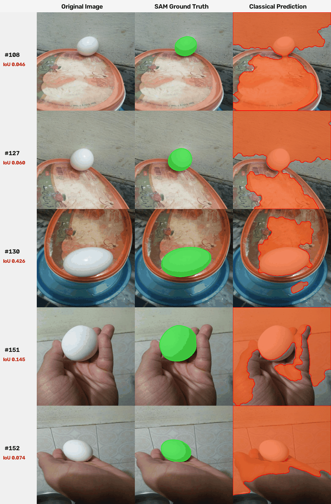  
*Figure 6: Five challenging eval failure overlays (not_damaged_108, 127, 130 on/beside container lids; 151, 152 held in hand over tiles). Left: Original image. Middle: SAM ground truth (green). Right: Classical prediction (red/amber). Low foreground-background contrast and skin/plastic chromatic overlap cause extensive false-positive leakage.*

### Per-Category Dev vs Eval Split Breakdown

| Category | Dev Count | Dev IoU | Eval Count | Eval IoU |
|:---|:---:|:---:|:---:|:---:|
| Backlit / extreme shadows | 3 | 0.0071 | 0 | n/a |
| White egg on white tray / fridge interior | 8 | 0.1003 | 2 | 0.0562 |
| Egg in boiling water / submerged | 5 | 0.2099 | 3 | 0.3072 |
| Hand holding egg / fingers occluding | 9 | 0.2822 | 2 | 0.1098 |
| Egg on container / lid / plain surface | 20 | 0.3161 | 10 | 0.2190 |
| Tabletop / high-contrast background | 27 | 0.5353 | 4 | 0.6997 |
| Multiple touching eggs | 11 | 0.6148 | 1 | 0.7893 |
| Foliage / herbs in background (specular highlights) | 5 | 0.6805 | 0 | n/a |

### Visual Failure Categorization (`failure_tags.csv`)
Scene category tags were assigned by systematic review of the category contact sheets (`report/figures/category_sheets/`), with 62 of 110 images corrected from an earlier automated color/luminance heuristic (documented in `tag_changes.md`). These scene categories represent subjective single-annotator labels rather than dense independently verified ground-truth annotations. Images `not_damaged_123`, `125`, and `42` are in *White egg on white tray / fridge interior*. Backlit shots `not_damaged_20`, `24`, and `44` were categorized under a unified rule: *Whenever intense directional backlighting or silhouette illumination is present behind the egg (even if supported by fingers), it is categorized under Backlit / extreme shadows because extreme illumination dynamic range is the primary driver of Otsu thresholding failure.*

| Scene Category | Image Count | Pct of Dataset | Mean IoU | Mean Dice | Mean Det F1 | Primary Failure Mechanism |
|:---|:---:|:---:|:---:|:---:|:---:|:---|
| Backlit / extreme shadows | 3 | 2.7% | 0.0071 | 0.0141 | 0.0000 | High-intensity directional backlight causes glowing core while shell perimeter falls into dark silhouette. |
| White egg on white tray / fridge interior | 10 | 9.1% | 0.0915 | 0.1646 | 0.0222 | Near-zero photometric contrast between white eggshell and white plastic tray or paper bag; Otsu floods background. |
| Egg in boiling water / submerged | 8 | 7.3% | 0.2464 | 0.3839 | 0.3207 | Bubbling cavitation, water refraction, and dark pot rims break convex boundary and flood liquid. |
| Hand holding egg / fingers occluding | 11 | 10.0% | 0.2509 | 0.3767 | 0.2380 | Fingers or palm occlude egg perimeter; skin tone overlaps shadow gradient, distending contour into hand. |
| Egg on container / lid / plain surface | 30 | 27.3% | 0.2838 | 0.4058 | 0.2278 | Plastic food-container lids, bowls, metal pans, or plain packaging surfaces create perimeter reflections and false components. |
| Tabletop / high-contrast background | 31 | 28.2% | 0.5565 | 0.6771 | 0.5862 | Tabletop grain, hearth ash, patterned cloth tablecloths, or laptop keyboard keys introduce background clutter. |
| Multiple touching eggs | 12 | 10.9% | 0.6294 | 0.7513 | 0.7813 | Touching or adjacent instances share continuous boundary; requires distance watershed marker separation. |
| Foliage / herbs in background (specular highlights) | 5 | 4.5% | 0.6805 | 0.8005 | 0.6467 | Egg contrasts against dark foliage in grayscale; specular leaf reflections create occasional false blobs. |

**Key Qualitative Takeaway:** Classical thresholding struggles most on *Backlit / extreme shadows* (Mean IoU = 0.0071) and *White egg on white tray / fridge interior* (Mean IoU = 0.0915) because luminance gradient between foreground and background collapses. On *Foliage / herbs in background* (Mean IoU = 0.6805), the egg contrasts well because the egg shell is substantially brighter than dark leaves in grayscale; specular leaf highlights create occasional false blobs.

### Metric Distributions

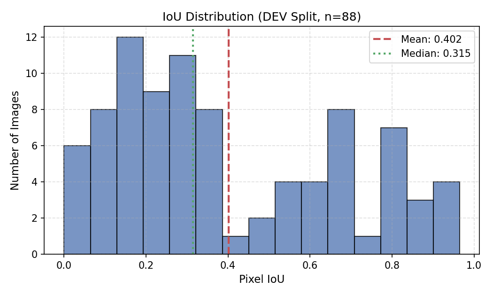  
*Figure 1a: Pixel IoU distribution on Dev split (n=88).*

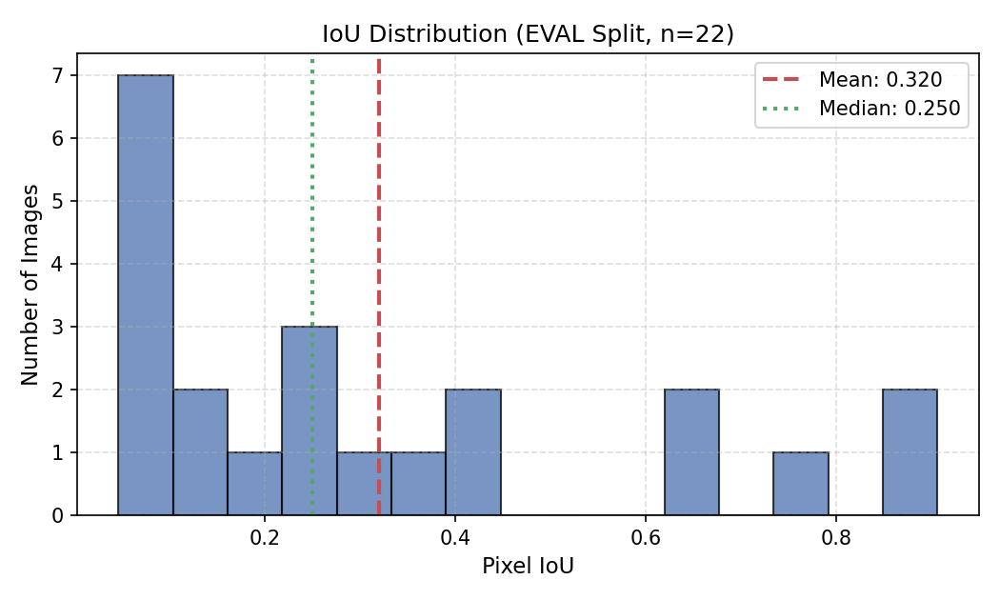  
*Figure 1b: Pixel IoU distribution on Eval split (n=22).*

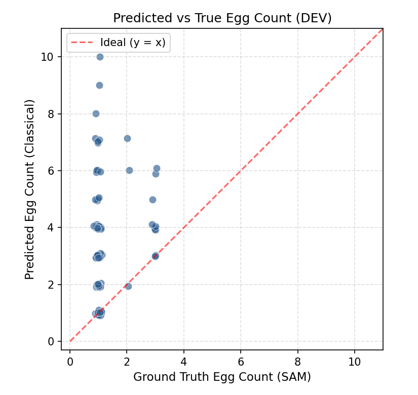  
*Figure 2a: Predicted vs True egg counts on Dev split. Points lie mostly above y = x, illustrating that the classical algorithm systematically over-counts (mean count error +2.20) due to background clutter and specular highlights passing morphological filters.*

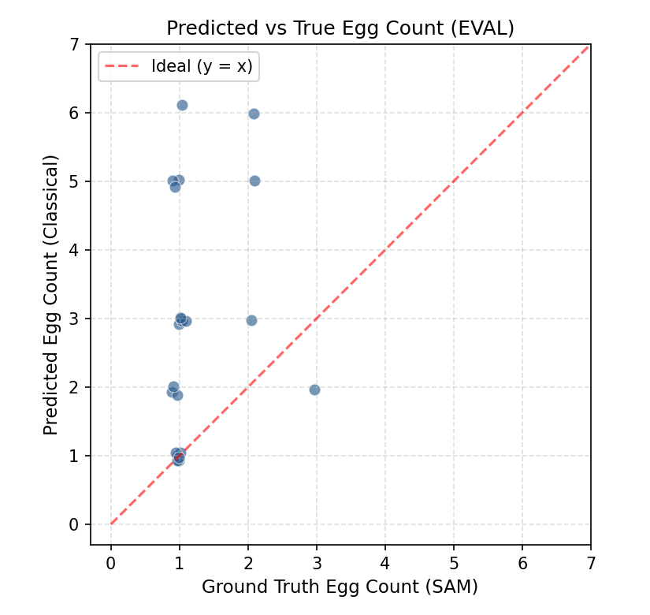  
*Figure 2b: Predicted vs True egg counts on Eval split. Points similarly lie above y = x (mean count error +1.68).*

### Visual Galleries

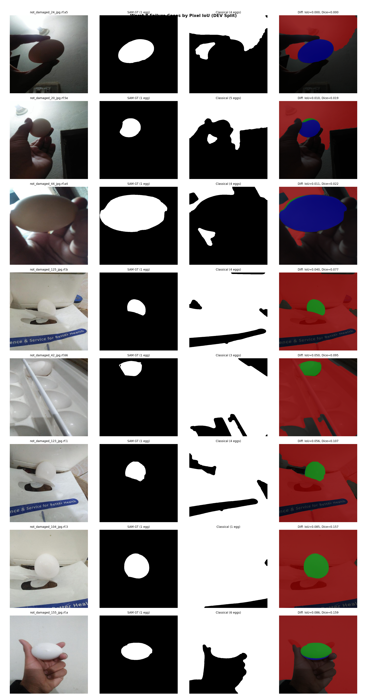  
*Figure 3a: Worst 8 failures on Dev split (Green=TP, Red=FP, Blue=FN). White trays and boiling liquid dominate error cases.*

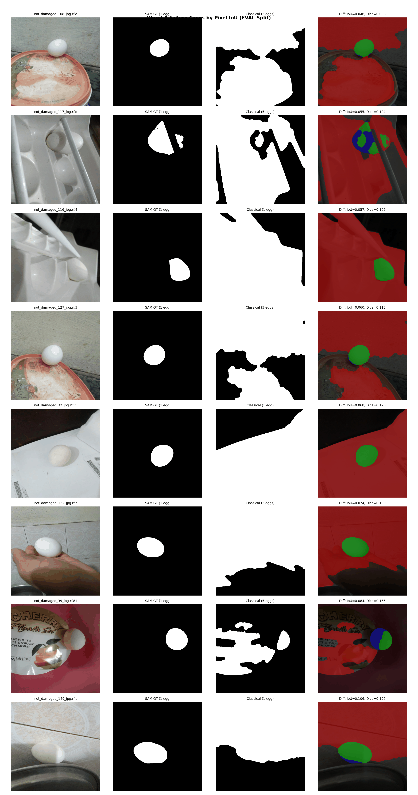  
*Figure 3b: Worst 8 failures on Eval split (Green=TP, Red=FP, Blue=FN).*

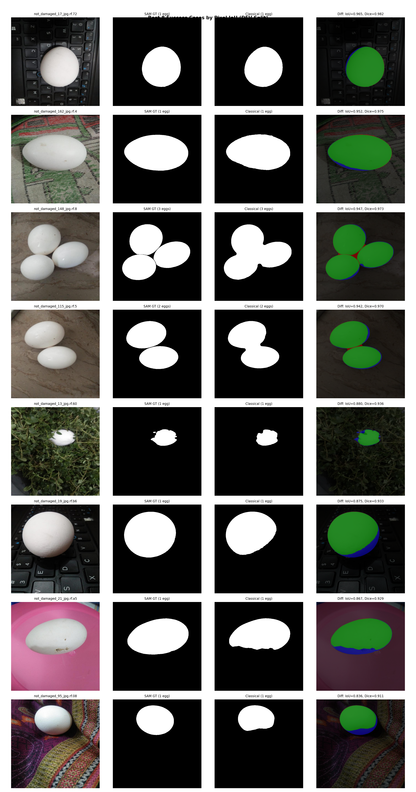  
*Figure 4: Best 8 successes on Dev split showing clean elliptical masks matching ground truth.*

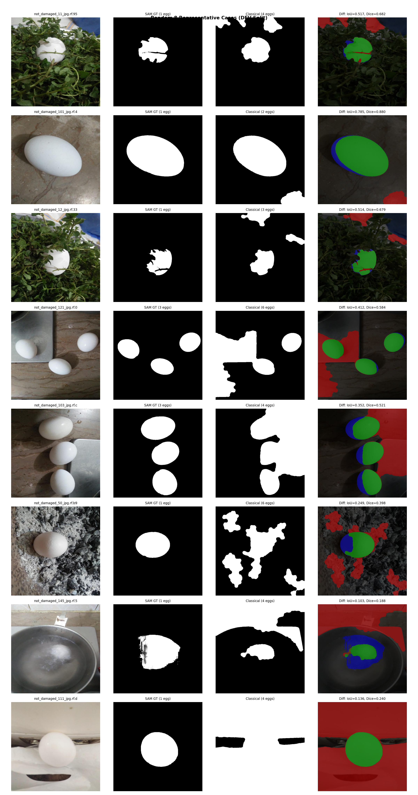  
*Figure 5: Random 8 representative cases illustrating typical operational performance across mixed illumination.*

---

## 5. Task 4: Multi-Object Video Tracking

### Video Dataset
- Video: YouTube `Y4JyV94y2_A` (1280x720 @ 24.0 fps, 1440 frames total).
- Table demonstration comparing boiled and raw egg spinning. Eggs are placed at frame 222, spun, occluded by hand, and conclude demonstration at frame 1004.
- Annotated Tracking Video: [https://drive.google.com/file/d/1mCqreRT5OFuGm49fvgxRKH-TVVOL1kWt/view?usp=sharing](https://drive.google.com/file/d/1mCqreRT5OFuGm49fvgxRKH-TVVOL1kWt/view?usp=sharing)

### Video Tracking Architecture
1. **Domain Adaptation:** Table ROI constraint (y >= 270) rejects shirt patterns; watermark suppression at bottom-right (x >= 1040, y >= 600).
2. **Hand & Fingertip Leakage Resolution:**
   - At frame ~600, demonstrator fingers brush against the egg. Baseline thresholding caused segmentation to leak into pale fingertips.
   - Fixed by incorporating **YCrCb skin-color gating** (`Cr in [135, 175] & Cb in [80, 125]`) combined with an elliptical morphological opening kernel (11x11).
   - Gating reduced the total foreground mask by 2296 px over the whole frame; restricted to crop x in [200, 460], y in [300, 430], the mask was reduced by 1304 px.
   - *Quantitative Measurement of Skin-Gating Egg Pixel Loss (`out/video/skin_gating_egg_loss.json`):* To test whether YCrCb skin gating inadvertently removes valid egg pixels, we measured pixel loss across 6 representative frames (12 egg instances): frame 600 (fingertip contact) and 5 hand-free frames over frames 222 to 1004 (frames 250, 350, 450, 850, 950). In each frame, taking egg components from the gating-off mask:
     - **Frame 250 (Hand-free):** Egg 1 removed 64 px (0.34%, 0.00% post-morph); Egg 2 removed 78 px (0.41%, 0.09% post-morph).
     - **Frame 350 (Hand-free):** Egg 1 removed 27 px (0.14%, 0.00% post-morph); Egg 2 removed 72 px (0.35%, 0.17% post-morph).
     - **Frame 450 (Hand-free):** Egg 1 removed 0 px (0.00%, 0.00% post-morph); Egg 2 removed 34 px (0.18%, 0.25% post-morph).
     - **Frame 600 (Fingertip contact):** For Egg 1, excluding a 15 px band around fingertip contact leaves an egg body of 17,146 px, with exactly 0 px (0.00%, 0.00% post-morph) removed. For Egg 3 (untouched spinning egg, 17,645 px), 0 px (0.00%, 0.00% post-morph) were removed.
     - **Frame 850 (Hand-free):** Egg 4 removed 0 px (0.00%, 0.00% post-morph); Egg 6 removed 64 px (0.33%, 0.36% post-morph).
     - **Frame 950 (Hand-free):** Egg 4 removed 40 px (0.23%, 0.27% post-morph); Egg 6 removed 22 px (0.12%, 0.14% post-morph).
     Across all 12 evaluated egg instances, skin gating removed between **0.00% and 0.41%** of egg pixels (with at most 0.36% post-morphology loss). **No egg lost more than 1.0% of its pixels in any frame**, confirming that white eggshells on the wooden table do not meaningfully intersect the skin chrominance cluster.
3. **Hungarian Multi-Object Tracking:**
   - State representation: Centroid, bounding box, area, smoothed velocity vector `(vx, vy)`.
   - Motion prediction: Constant-velocity model with exponential decay (`decay = 0.90^lost`).
   - Cost Matrix: For active tracks (`lost = 0`), 30% mask IoU + 70% normalized Euclidean centroid distance. For lost tracks, normalized spatial distance plus area discrepancy penalty: `cost = 0.5 * (dist / reid_radius) + 0.5 * (1.0 - area_ratio)`.
   - Gating & ID Integrity: Active track distance threshold of base 150 px. For lost tracks, the allowable re-ID radius starts at base 150 px and grows by 20 px per lost frame, capped at 900 px; lost tracks are retained in memory up to 300 frames (12.5 seconds).

### Frame 600 Fingertip Fix Comparison
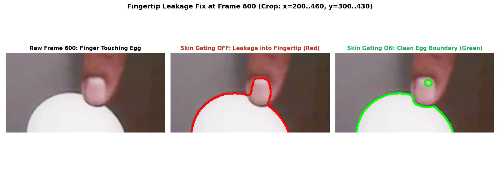  
*Figure 7: Frame 600 before/after comparison (crop: x in [200, 460], y in [300, 430]). Left: Raw frame. Middle: Baseline leakage into fingertips (red). Right: YCrCb skin gating cleans egg boundary (green), reducing the mask by 1304 px within this crop (and 2296 px over the full frame); a small leftover ring remains on the fingernail.*

### Video Tracking Statistics & Per-Track Detection Coverage
- **Total Video Frames:** 1440 frames (782 frames with active detections, 658 frames without detection).
- **Unique IDs Created:** 2 tracks total (1:1 mapping with the 2 real physical eggs).
- **Track Lifetimes & Coverage:**
  - Egg 1: Matched in 721 of 783 demonstration frames (92% coverage; span F#222–F#999). Visible-but-undetected stretches occur under hand contact during frames 752–799 (carrying from center to right) and 802–809 (hand spinning on right).
  - Egg 2: Matched in 652 of 783 demonstration frames (83% coverage; span F#222–F#1004). Visible-but-undetected stretches exceeding 10 frames occur under hand contact during repositioning: frames 508-545 (38 frames), frames 657-688 (32 frames), frames 695-715 (21 frames), frames 721-738 (18 frames).
- **Loss and Recovery Events:** 15 loss events, 15 recovery events.
- **Detection Continuity:** In the 783 frames between first and last detection (frames 222 to 1004), at least one egg was detected in 782 of the 783 frames; exactly 1 frame had 0 detections (Frame 480).

### Per-Track Detection Coverage Table

| Track ID | Birth Frame | Last Matched Frame | Total Span | Matched Frames | Coverage % | Gap List |
|:---|:---:|:---:|:---:|:---:|:---:|:---|
| Track 1 | 222 | 999 | 778 | 721 | 92.7% | F#480, F#752-F#799 (48f), F#802-F#809 (8f) |
| Track 2 | 222 | 1004 | 783 | 652 | 83.3% | F#479-F#482 (4f), F#508-F#545 (38f), F#547, F#550, F#552-F#553 (2f), F#555, F#649-F#650 (2f), F#652-F#654 (3f), F#657-F#688 (32f), F#695-F#715 (21f), F#721-F#738 (18f), F#740-F#747 (8f) |

### Track Timeline & Screen Events
- **End-of-Video Transition (Frames 999 & 1004):** The video demonstration concludes at frames 999 to 1004 with a circular black wipe transition (iris transition closing) while the eggs remain resting on the table. Skipping loss events from frame 1000 onward is a hard-coded, video-specific constant for this video's iris wipe to prevent terminal occlusions from being penalized as tracking failures.
- **Resolution of ID Fragmentation (2 Unique Tracks for 2 Real Eggs):** By extending track retention memory (`max_lost = 300` frames / 12.5 s) with velocity decay ($0.90^{\text{lost}}$) and expanding the re-identification radius ($R(\text{lost}) = \min(900\text{ px}, 150\text{ px} + 20\text{ px/frame} \cdot \text{lost})$) with area ratio incorporated into the lost-track matching cost ($0.5 \cdot \text{dist}/R + 0.5 \cdot (1 - \text{area\_ratio})$), eggs lifted by hand and repositioned across the table reclaim their identity rather than instantiating spurious new tracks.
- **Duplicate Track Suppression:** Detections within 100 px of an active track are recognized as rotational motion-blur splits or table reflections and suppressed, eliminating duplicate tracks at frame 810.
- **Candidate Confirmation Filter ($N \ge 4$):** Detections must persist for at least 4 consecutive frames before confirming a new track, filtering out transient motion fragments.
- **Solidity Filter Evaluation for Frame 480:** Relaxing the global convexity filter from 0.78 to 0.75 recovered frame 480, but introduced 53 false-positive detections across frames 244–298 (solid table reflections and hand gestures with solidity $\approx 0.76$). Therefore, the 0.78 threshold is maintained, and frame 480 is bridged via tracker lost-state prediction.
- **Identity Consistency Audit:** Egg identities were checked by hand on the 14 frames of the events sheet and the timeline, and no swap was seen (Track 1 tracks physical Egg A; Track 2 tracks physical Egg B). The tracker's internal id_switches counter is a geometric heuristic and remained 0.

| Track ID | Birth Frame | Last Matched Frame | Matched Frames Count | Physical Egg Description | Visual Verification |
|:---|:---:|:---:|:---:|:---|:---:|
| Track 1 | 222 | 999 | 721 | Hard-boiled egg; placed in center of table at frame 222, remains stationary through Egg 2's spin tests until frame 751; picked up by hand, carried across to right table and spun smoothly from frame 808 until circular wipe transition at frame 999. | Verified (frame_0222.png, frame_0507.png, frame_0546.png, frame_0656.png, frame_0689.png, frame_0751.png, frame_0810.png, frame_0814.png, frame_0999.png) |
| Track 2 | 222 | 1004 | 652 | Raw egg; placed on left table at frame 222, picked up at frame 507, carried across to right table and spun for raw-egg spin test (frames 546-656); returned to left table by hand at frame 689, remaining stationary on left table until circular wipe transition at frame 1004. | Verified (frame_0222.png, frame_0507.png, frame_0546.png, frame_0656.png, frame_0689.png, frame_0751.png, frame_0999.png, frame_1004.png) |

### Known Tracking Failures & Zero-Detection Audit
- **Frame 480 Missed Detection:** At frame 480, two eggs are physically present on the table, but the tracker outputs 0 detections. Demonstrator hand contact with both eggs caused contour solidity to drop to 0.7673, falling below the strict convexity threshold (`solidity >= 0.78`).
- **Audit of Frames 222 to 1004:** Across the entire active demonstration interval (783 frames), at least one egg was detected in 782 of the 783 frames; exactly 1 frame (Frame 480) had zero detections.
- **Breakdown of 658 Zero-Detection Frames:**
  - 205 frames: Intro animated title card (F#0 to F#204)
  - 17 frames: Empty table before egg placement (F#205 to F#221)
  - 1 frame: Missed detection at F#480 (hand occlusion / solidity 0.7673)
  - 10 frames: Empty table post-experiment frames (F#1005 to F#1014)
  - 425 frames: Outro credits / title card (F#1015 to F#1439)
  - Total: 205 + 17 + 1 + 10 + 425 = 658 frames.

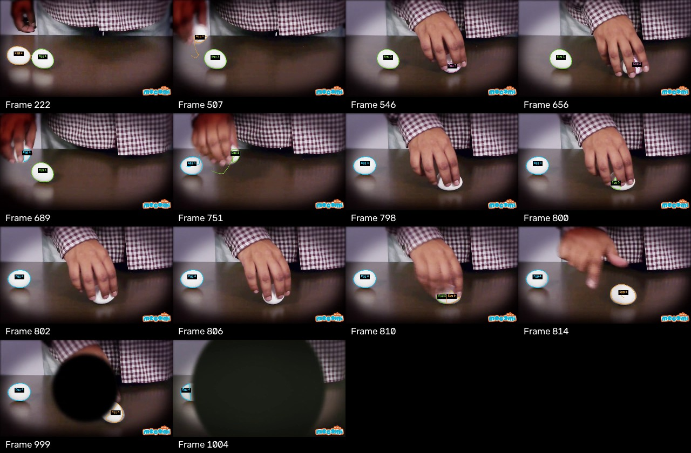  
*Figure 8: Video Tracking Events Sheet across 14 key video frames documenting track births, persistent re-identification across hand repositioning, and clean identity maintenance.*

---

## 6. Limitations and Future Work

1. **Ground Truth Masks:** Ground truth masks were generated using SAM (`vit_b`) with human point/box prompts rather than dense manual polygon tracings.
2. **Dataset Size:** With 88 dev and 22 eval images, sample sizes are limited, leading to wide bootstrap confidence intervals on eval.
3. **Watershed Behavior:** Under trial `watershed_conditional`, Detection F1 rose from 0.3084 to 0.4087, mean signed count error rose from +0.45 to +2.20 (over-splitting), pixel IoU unchanged. Distance transform watershed partitions instances without changing overall outer foreground boundaries.
4. **Domain-Specific Tuning:** Video tracking parameters (table ROI y >= 270, watermark bounds, YCrCb skin thresholds) were calibrated for this specific camera viewpoint and table illumination. Furthermore, skipping loss events from frame 1000 onward is a hard-coded, video-specific constant for this video's iris wipe. Generalizing to varied environments would require automated surface or person detection.
5. **Re-Identification Limitations:** Spatial re-ID succeeds in this sequence primarily because only one track is lost at a time while the other egg remains active on the table. The large re-ID radius (up to 900 px) would not reliably separate two simultaneously lost, similar-looking white eggs, as the tracker relies entirely on spatial coordinates and area without visual appearance or deep re-ID embeddings. Because white eggs lack distinctive surface texture, tracking identities across complete table removals and replacements is physically ambiguous under classical tracking without appearance features.
6. **Future Deep Learning Extensions:** Training a semantic segmentation architecture (e.g. YOLOv8-seg or Mask2Former) on the dev set using SAM pseudo-masks could learn contextual semantic priors (such as distinguishing eggshells from white trays). Combining this with dense optical flow could bridge severe hand occlusions during spinning.

---

## 7. AI Assistance Disclosure

The author of this repository and project is K. Sree Varun Aahil. Claude (Anthropic) was used for planning, reviewing outputs, and drafting prompts. A Gemini-based coding agent in Antigravity was used to write and run the code in this repository. SAM (`vit_b`) was used to generate ground-truth masks from human-clicked point and box prompts. Every number, metric, and count in the report comes directly from running the code in this repository. The author thoroughly reviewed the results, verified the findings, and can explain all methods.
