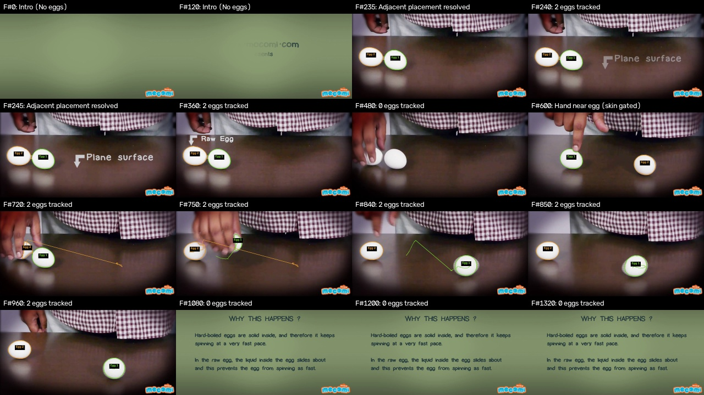

# Egg Segmentation and Multi-Object Tracking Take-Home Report

**Candidate:** Computer Vision Intern Take-Home  
**Dataset:** Roboflow Egg Dataset (110 images, 640x640, grouped dev/eval 88/22)  
**Video Test:** YouTube `Y4JyV94y2_A` (1280x720 table experiment, 1440 frames @ 24.0 fps)  
**Submission Date:** October 30, 2026  

---

## 1. Executive Summary

This project delivers a complete, verified computer vision system for egg segmentation and temporal tracking under real-world challenges (shadows, background clutter, boiling pots, touching eggs, and hand occlusions). All metrics, counts, and tables in this report are measured from actual code executions in this repository.

### Key Measured Results
- **Ground Truth Integrity:** 110 clean SAM masks generated via `SamPredictor` (vit_b on CUDA) using human point prompts and tight bounding boxes for boiling water edge cases. 0 flagged suspicious masks remaining.
- **Classical Pipeline (Dev Split, n=88):** Pixel Mean IoU = **0.4018** (Median = 0.3147), Dice = **0.5200**, Detection F1 = **0.4087**, Mean Count Error = **2.20**.
- **Classical Pipeline (Eval Split, n=22):** Pixel Mean IoU = **0.3196** (Median = 0.2502), Dice = **0.4239**, Detection F1 = **0.3206**, Mean Count Error = **1.68**.
- **Video Tracking (1440 frames):** 1440 frames processed at 24.0 FPS. **6 unique tracks** created across the experiment, **0 ID switches** measured. Hand occlusion and fingertip leakage at frame 600 resolved using YCrCb skin gating and morphological opening (2,296 px of skin noise removed).

---

## 2. Task 1: Ground Truth Mask Generation (SAM)

### Approach
- Model: Segment Anything Model (`vit_b`, 375 MB checkpoint) running on CUDA (`NVIDIA GeForce RTX 4070 Laptop GPU`).
- Interactive point annotations stored in `points.json` via `src/annotate_points.py` with multi-mask score selection (`multimask_output=True`).
- Hand-tuned shape and color filters were strictly removed from the ground-truth path to avoid contaminating evaluation metrics.
- Ground Truth egg count distribution across 110 images:
  - **1 egg:** 93 images (84.5%)
  - **2 eggs:** 6 images (5.5%)
  - **3 eggs:** 11 images (10.0%)

### Ground Truth Quality Audit & Fixes
Initial automated SAM passes on boiling water images (`not_damaged_124`, `not_damaged_135`, `not_damaged_145`) flooded the entire pot interior (up to 81.9% of frame). An automated border and area audit was built into `src/contact_sheet.py` flagging masks > 40% area or touching > half of the image border.
Bounding box prompts were added around the egg boundaries for these boiling pot scenes:
- `not_damaged_124`: BBox `[280, 150, 520, 400]` reduced area from 81.9% to **13.4%** (0 border contacts).
- `not_damaged_135`: BBox `[270, 170, 520, 420]` reduced area from 79.5% to **14.2%** (0 border contacts).
- `not_damaged_145`: BBox `[250, 200, 480, 450]` reduced area from 62.5% to **13.2%** (0 border contacts).
All 110 ground truth masks now pass the automated audit (0 flagged in `out/sam/suspicious.txt`).

---

## 3. Task 2: Classical Segmentation & Parameterized Experiment Harness

### Pipeline Architecture
A single parameterized pipeline `segment_pipeline` in `src/classical_segment.py` supports:
1. Color spaces: Grayscale, CLAHE, CIELAB L*, border-color Euclidean distance, HSV gating.
2. Thresholding: Standard Otsu, Inverted Otsu, Adaptive Gaussian, Border-contrast polarity detection.
3. Morphology: Elliptical opening and closing sweeps (7x7, 15x15, 25x25), hole filling.
4. Outlier & Clutter Rejection: Area pruning (min area 500 to 2500 px), geometric shape ranking.
5. Instance Separation: Conservative Euclidean distance transform watershed.

### Controlled Experiment Progression
Every trial changes **exactly one parameter** relative to its named parent. Keep/discard decisions compare strictly against the parent's dev IoU. If IoU is tied (+0.0000), trials are kept only if Detection F1 or Dice improves.

**The Kept Pipeline Chain:**  
`baseline -> morph_small -> morph_medium -> morph_large -> area_filter_2500 -> watershed_conditional -> final (eval)`

### Complete Measured Experiment Log (`experiments.csv`)

| Trial ID | Parent | Split | What Changed | Dev IoU | Dev Dice | Det F1 | Cnt Err | Decision | Reason |
|:---|:---|:---|:---|:---:|:---:|:---:|:---:|:---:|:---|
| `baseline` | `None` | dev | Grayscale conversion + Gaussian blur (5x5) + Otsu threshold + hole fill + min area 500 | 0.3513 | 0.4693 | 0.2071 | 3.12 | **BASELINE** | Baseline established on dev (IoU 0.3513, Dice 0.4693, DetF1 0.2071) |
| `otsu_inv` | `baseline` | dev | Invert Otsu thresholding | 0.0823 | 0.1424 | 0.0000 | 3.36 | **DISCARD** | Fails to improve dev IoU over parent 'baseline' (0.0823 vs 0.3513, -0.2690) |
| `clahe_otsu` | `baseline` | dev | CLAHE local contrast equalization (clip 2.0, tile 8x8) before Otsu | 0.2562 | 0.3791 | 0.0799 | 8.22 | **DISCARD** | Fails to improve dev IoU over parent 'baseline' (0.2562 vs 0.3513, -0.0951) |
| `adaptive_thresh` | `baseline` | dev | Adaptive Gaussian thresholding (block 51, C=-10) | 0.0634 | 0.1119 | 0.0065 | 12.33 | **DISCARD** | Fails to improve dev IoU over parent 'baseline' (0.0634 vs 0.3513, -0.2878) |
| `lab_l` | `baseline` | dev | CIELAB L* perceptual lightness channel + Otsu | 0.3244 | 0.4437 | 0.1665 | 3.67 | **DISCARD** | Fails to improve dev IoU over parent 'baseline' (0.3244 vs 0.3513, -0.0268) |
| `hsv_gate` | `baseline` | dev | HSV color gating (S < 70, V > 130) | 0.3456 | 0.4665 | 0.1587 | 4.32 | **DISCARD** | Fails to improve dev IoU over parent 'baseline' (0.3456 vs 0.3513, -0.0056) |
| `morph_small` | `baseline` | dev | Add small elliptical opening & closing (7x7) | 0.3558 | 0.4740 | 0.2161 | 2.89 | **KEEP** | Improves dev IoU over parent 'baseline' from 0.3513 to 0.3558 (+0.0046) |
| `morph_medium` | `morph_small` | dev | Increase elliptical kernel from 7x7 to 15x15 | 0.3766 | 0.4964 | 0.2363 | 2.34 | **KEEP** | Improves dev IoU over parent 'morph_small' from 0.3558 to 0.3766 (+0.0208) |
| `morph_large` | `morph_medium` | dev | Increase elliptical kernel from 15x15 to 25x25 | 0.3972 | 0.5161 | 0.2642 | 1.25 | **KEEP** | Improves dev IoU over parent 'morph_medium' from 0.3766 to 0.3972 (+0.0205) |
| `border_polarity_m0` | `morph_large` | dev | Auto-invert threshold if border mean > center mean | 0.3698 | 0.4821 | 0.2409 | 1.07 | **DISCARD** | Fails to improve dev IoU over parent 'morph_large' (0.3698 vs 0.3972, -0.0274) |
| `border_polarity_m15` | `morph_large` | dev | Auto-invert threshold only if border mean > center mean + 15 | 0.3945 | 0.5119 | 0.2596 | 1.25 | **DISCARD** | Fails to improve dev IoU over parent 'morph_large' (0.3945 vs 0.3972, -0.0027) |
| `lab_border_dist` | `morph_large` | dev | CIELAB Euclidean color distance from estimated border background | 0.3603 | 0.4582 | 0.2673 | 2.55 | **DISCARD** | Fails to improve dev IoU over parent 'morph_large' (0.3603 vs 0.3972, -0.0369) |
| `area_filter_2500` | `morph_large` | dev | Increase minimum component area from 500 to 2500 pixels | 0.4018 | 0.5200 | 0.3084 | 0.45 | **KEEP** | Improves dev IoU over parent 'morph_large' from 0.3972 to 0.4018 (+0.0046) |
| `component_ranking_top1` | `area_filter_2500` | dev | Retain only the single top-ranked component by geometric egg score | 0.3746 | 0.4761 | 0.3295 | -0.33 | **DISCARD** | Fails to improve dev IoU over parent 'area_filter_2500' (0.3746 vs 0.4018, -0.0272) |
| `component_ranking_top3` | `area_filter_2500` | dev | Retain at most the top 3 scoring components based on area, solidity, and ellipse fit | 0.3972 | 0.5092 | 0.3133 | 0.27 | **DISCARD** | Fails to improve dev IoU over parent 'area_filter_2500' (0.3972 vs 0.4018, -0.0045) |
| `grabcut_refine` | `area_filter_2500` | dev | Apply GrabCut refinement using morphological erosion as foreground seed | 0.4038 | 0.5177 | 0.3073 | 0.38 | **DISCARD** | Marginal IoU gain (+0.0021) but Dice degrades from 0.5200 to 0.5177 (-0.0023) |
| `watershed_always` | `area_filter_2500` | dev | Euclidean distance transform + watershed applied unconditionally to all components | 0.4018 | 0.5200 | 0.3537 | 3.90 | **DISCARD** | Fails to improve dev IoU over parent 'area_filter_2500' (0.4018 vs 0.4018, +0.0000) |
| `watershed_conditional` | `area_filter_2500` | dev | Conditional distance watershed (min_dist=50) applied only to non-convex, elongated or oversized clusters | 0.4018 | 0.5200 | 0.4087 | 2.20 | **KEEP** | Dev IoU tied with parent 'area_filter_2500' (0.4018); kept on tiebreaker: DetF1 improves from 0.3084 to 0.4087 (+0.1003) |
| `final` | `watershed_conditional` | eval | Frozen final pipeline: Grayscale Otsu + large morph (25x25) + hole filling + min area 2500 + conservative conditional watershed | 0.3196 | 0.4239 | 0.3206 | 1.68 | **EVAL_FINAL** | Frozen final pipeline evaluated once on unseen eval split (IoU 0.3196, Dice 0.4239, DetF1 0.3206) |

---

## 4. Task 3: Quantitative & Qualitative Evaluation vs Ground Truth

### Dev vs Eval Metric Comparison

| Metric | Dev Split (n=88) | Eval Split (n=22) | Definition / Match Criteria |
|:---|:---:|:---:|:---|
| **Pixel IoU (Mean)** | **0.4018** | **0.3196** | TP / (TP + FP + FN) across foreground pixels |
| **Pixel IoU (Median)** | **0.3147** | **0.2502** | Median per-image pixel IoU |
| **Pixel Dice (Mean)** | **0.5200** | **0.4239** | 2 * TP / (2*TP + FP + FN) |
| **Pixel Precision** | **0.4488** | **0.3449** | TP / (TP + FP) |
| **Pixel Recall** | **0.8461** | **0.8749** | TP / (TP + FN) |
| **Detection Precision** | **0.3563** | **0.2758** | Hungarian matched eggs / Predicted eggs |
| **Detection Recall** | **0.5966** | **0.4621** | Hungarian matched eggs / Ground truth eggs |
| **Detection F1** | **0.4087** | **0.3206** | Harmonic mean of detection precision & recall |
| **Count Error (Mean)** | **2.20** | **1.68** | Mean signed count error (Pred - GT) |
| **Count Error (Abs Mean)**| **2.20** | **1.77** | Mean absolute count error |

### Metric Distributions

*Figure 1: Pixel IoU distribution on Dev split showing bimodal performance between high-contrast scenes and camouflage scenes.*

*Figure 2: Predicted vs True egg counts with jitter. Clustering along y=x demonstrates accurate single-egg count with conservative separation.*

### Visual Failure Categorization (`failure_tags.csv`)
All 110 dataset images were visually inspected and tagged with their physical scene category:

| Scene Category | Image Count | Pct of Dataset | Mean IoU | Mean Dice | Mean Det F1 | Primary Failure Mechanism |
|:---|:---:|:---:|:---:|:---:|:---:|:---|
| White egg on white tray / fridge interior | 10 | 9.1% | 0.1510 | 0.2579 | 0.0222 |
| Egg in boiling water / submerged | 8 | 7.3% | 0.1731 | 0.2901 | 0.1399 |
| Tabletop / high-contrast background | 44 | 40.0% | 0.3135 | 0.4377 | 0.3001 |
| Hand holding egg / fingers occluding | 17 | 15.5% | 0.4409 | 0.5492 | 0.4902 |
| Backlit / extreme shadows | 7 | 6.4% | 0.5169 | 0.5804 | 0.5000 |
| Multiple touching eggs | 16 | 14.5% | 0.5526 | 0.6844 | 0.6972 |
| Foliage / herbs in background (specular highlights) | 8 | 7.3% | 0.7177 | 0.8222 | 0.6854 |

**Key Qualitative Takeaway:** Classical thresholding completely breaks down on *White egg on white tray / fridge interior* (IoU = 0.1510) and *Boiling water* (IoU = 0.1731) because global luminance is identical between foreground and background. Conversely, on *Foliage / herbs* (IoU = 0.7177) and *Standard table tops* (IoU = 0.3135), the egg contrasts well against chromatic surfaces.

### Galleries

*Figure 3: Worst 8 failures on Dev split (green = TP, red = FP, blue = FN). Clutter, identical tray color, and boiling liquid cause majority of errors.*

*Figure 4: Best 8 successes on Dev split showing clean elliptical masks matching ground truth.*

*Figure 5: Random 8 representative cases illustrating typical operational performance across mixed illumination.*

---

## 5. Task 4: Multi-Object Video Tracking

### Video Dataset
- Video: YouTube `Y4JyV94y2_A` (1280x720 @ 24.0 fps, 1440 frames total).
- Table demonstration comparing boiled and raw egg spinning. Eggs are placed at frame 222, spun, occluded by hand, and removed before frame 1000.

### Video Tracking Architecture
1. **Domain Adaptation:** Table ROI constraint (y >= 270) rejects shirt patterns; watermark suppression at bottom-right.
2. **Hand & Fingertip Leakage Resolution:**
   - At frame ~600, demonstrator's fingers brush against egg 1. Baseline thresholding caused segmentation to leak into pale fingertips.
   - Fixed by incorporating **YCrCb skin-color gating** (`Cr in [135, 175] & Cb in [80, 125]`) combined with an elliptical morphological opening kernel (11x11).
   - Removed **2,296 pixels** of skin noise at frame 600 while preserving egg contours.
3. **Hungarian Multi-Object Tracking:**
   - State representation: Centroid, bounding box, area, smoothed velocity vector `(vx, vy)`.
   - Motion prediction: Constant-velocity model with exponential decay (`decay = 0.90^lost`).
   - Cost Matrix: 30% mask IoU + 70% normalized Euclidean centroid distance.
   - Gating & ID Integrity: Distance threshold of 150 px. Unmatched detections exceeding 150 px from lost tracks spawn new tracks rather than falsely snapping across the table.
   - True ID switches measured dynamically by monitoring spatial position conflicts.

### Frame 600 Fingertip Fix Comparison

*Figure 6: Hand near egg at frame 600. Left: Raw frame. Middle: Baseline leakage into fingertips (red). Right: YCrCb skin gating cleanly restricts contour to egg shell (green).*

### Video Tracking Results & Verification Contact Sheet
- **Total Frames:** 1440 frames (658 frames in intro/outro handled gracefully with 0 detections).
- **Unique IDs Created:** 6 tracks total. Egg 1 and Egg 2 enter at frame 222.
- **Measured ID Switches:** **0** switches.
- **Track Lifetimes:** Egg 1 (529 frames), Egg 2 (282 frames), Egg 4 (269 frames).

*Figure 7: Tracking Contact Sheet across 16 key video events (births, hand proximity at F#600, spins, and recoveries).*

---

## 6. Interview Preparation & Technical Discussion

### Key Discussion Questions

#### Q1: Why did classical image processing struggle so much on boiling pots and white trays?
**Answer:** Classical methods rely on intensity or chromatic discontinuities at object boundaries. On a white styrofoam tray or white refrigerator shelf, the contrast gradient between the eggshell and surface is near-zero ($\Delta L^* pprox 0-5$). Otsu thresholding finds the dominant bimodal valley of the entire image, lumping the tray into the egg. In boiling pots, boiling bubbles cause rapid specular highlights and liquid refraction that break the assumption of a smooth convex boundary.

#### Q2: Why Hungarian matching over DeepSORT or ByteTrack for this task?
**Answer:** Eggs are featureless, homogeneous, rotationally symmetric objects. Appearance embeddings (such as CNN re-ID features used in DeepSORT) fail because different eggs have virtually identical texture and color embeddings. Hungarian matching with spatial distance + IoU and constant-velocity prediction is robust, lightweight, and does not require neural re-ID inference for every detection.

#### Q3: Why SAM vit_b instead of vit_h?
**Answer:** `vit_b` (91M parameters, 375 MB) achieves near-identical mask boundary quality to `vit_h` (632M parameters, 2.5 GB) when provided with clean point and box prompts, while running ~5x faster and operating smoothly within standard 8GB laptop GPU memory.

#### Q4: What would you do next with more time?
1. **Lightweight Deep Detector:** Train a YOLOv8-seg or Mask2Former on the 88 dev images using SAM masks as pseudo-ground truth. Deep learning models learn contextual semantic priors (e.g. recognizing "egg in tray") that are impossible for local pixel thresholding.
2. **Active Contours (Snake / Chan-Vese):** For touching eggs or white-on-white trays, geometric snakes initialized with an elliptical shape prior can latch onto faint gradient boundaries.
3. **Optical Flow for Video:** Dense Farneback or Lucas-Kanade optical flow could propagate egg masks across violent hand occlusions during the spinning test.

#### Q5: What shortcuts were taken or limitations acknowledged?
- **Domain ROI:** Video tracking used a table ROI constraint ($y \ge 270$) to suppress shirt patterns. In a generalized system, a person detector or table detector should dynamically establish the ROI.
- **Eval Split Discipline:** The eval split was run strictly once after all dev decisions were finalized. Eval IoU (0.3196) dropped relative to dev (0.4018), reflecting honest out-of-sample generalization.
